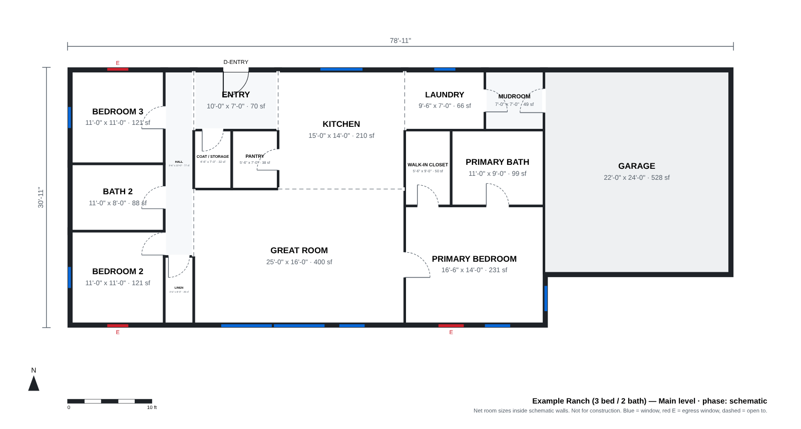

# arch-design-kit

A foundation for prompting Claude to design and model houses and small structures. The kit answers three questions:

1. **What helps internally?** → [INTERNAL-TOOLS-SURVEY.md](INTERNAL-TOOLS-SURVEY.md) lists the skills, plugins and connectors in the Claude ecosystem that help with 3D CAD and architectural drawings, and the order to set them up.
2. **Which AI tools exist, and how do they align with Claude?** → [the research report](research/reports/AI%20tools%20for%20CAD%20and%20architecture.md) gives the evidence: code-driven CAD and MCP connectors, BIM and AI-native platforms, generative 3D, rendering and capture. It ends with a three-tier recommended stack and the workflow the evidence supports. All 144 citations live in [research_notes/](research/research_notes/). [PROMPTING-GUIDE.md](PROMPTING-GUIDE.md) turns the findings into prompts.
3. **How do we design well every time?** → [the Design Playbook](playbook/README.md) is the base layer. It holds the principles, the US code baseline, structure, envelope, space planning, drawing and BIM standards, and process, all on [one rulebook page](playbook/RULES.md) with stable rule IDs. On top sit swappable [style modules](playbook/styles/catalog.md), [project templates](templates/), and [tools](tools/) that enforce the rulebook.

> This kit lives in `red-line-toolkit/arch-design-kit/` for now and is built to move to its own repository unchanged (see [below](#moving-this-folder-to-its-own-repo)).

## Layout

```
arch-design-kit/
├── README.md                    you are here
├── INTERNAL-TOOLS-SURVEY.md     part 1: skills, plugins, connectors to use
├── PROMPTING-GUIDE.md           how to prompt Claude for CAD and drawings, by phase
├── FREECAD.md                   FreeCAD + freecad-mcp: setup, the loop, version traps
├── research/
│   ├── reports/                 part 2: AI tools for CAD and architecture (the report)
│   └── research_notes/          7 sourced note files behind the report and the playbook
├── playbook/                    part 3: the foundation
│   ├── README.md                how the layers stack; how to use it on a project
│   ├── RULES.md                 every rule, one line, with ID, kind, basis, auto-check
│   ├── 01-foundation.md         priority stack, program-first, plan principles
│   ├── 02-code-baseline.md      IRC 2021/2024 minimums, zoning inputs, energy, crosswalk
│   ├── 03-structure-and-buildability.md
│   ├── 04-envelope-climate-mep.md
│   ├── 05-space-planning.md     room targets, NKBA kitchens/baths, circulation, UD tiers
│   ├── 06-drawing-and-model-standards.md   units, spec format, LOD, IFC, NCS sheets/layers
│   ├── 07-process-and-workflow.md          the loop, phases and gates, professional boundary
│   ├── 08-concept-design.md     creativity: readiness, surprise dial, lenses, critic, push then pull
│   ├── precedents.md            starter library: canonical + vernacular houses, each with the move to take
│   ├── provocations.md          the deck of analogies and provocation cards
│   ├── CHECKLISTS.md            per-iteration check + gate checklists
│   ├── VERIFY.md                values to confirm against the primary code text
│   └── styles/                  style-module system + catalog of 12 American styles
├── templates/                   copy into each new project
│   ├── CLAUDE.md                makes every session in the project follow the playbook
│   ├── PROJECT-BRIEF.md · PROGRAM.md · DECISIONS.md · design.yaml
│   ├── TASTE.md · PRECEDENTS.md · CONCEPTS.md   the creative groundwork
├── tools/
│   ├── check_design.py          holds a design.yaml to the rulebook (stdlib + PyYAML)
│   ├── render_plan.py           design.yaml → schematic SVG floor plans
│   ├── spec_to_ifc.py           design.yaml → IFC4 model (spaces, walls, doors, windows, slab)
│   ├── freecad_load_ifc.py      runs inside FreeCAD: loads that IFC and reports what FreeCAD built
│   ├── ready_check.py           "are we ready to design?": brief, program, taste, precedents, concept
│   ├── explore_variants.py      searches a concept family; keeps the most different that pass
│   ├── concept_board.py         concept cards with parti/section diagrams; blind jury pack
│   ├── deal.py                  deals each concept lens its own precedents, analogy, provocation
│   ├── sun.py                   solstice sun angles, shadows, overhang depths for a latitude
│   ├── test_tools.py            tests for every tool, including rulebook consistency
│   └── requirements.txt
├── examples/ranch-3bed/         a worked spec + its generated plan (SVG/PNG) and IFC
├── examples/bar-house/          a complete concept-family generator for explore_variants.py
├── examples/court-house/        a rooms-only sketch generator (concept mode)
├── skills/arch-design-playbook/ the Claude skill that loads all of this automatically
├── skills/concept-studio/       the creative concept phase (playbook 08)
├── hooks/hooks.json             warns before design work when the creative groundwork is missing
└── .claude-plugin/plugin.json   makes the folder installable as a Claude Code plugin
```

## Quick start

```bash
cd arch-design-kit
pip install -r tools/requirements.txt          # PyYAML is enough for the checker and plans

python3 tools/check_design.py examples/ranch-3bed/design.yaml
python3 tools/render_plan.py  examples/ranch-3bed/design.yaml          # → examples/ranch-3bed/out/L1-plan.svg
python3 tools/spec_to_ifc.py  examples/ranch-3bed/design.yaml          # → examples/ranch-3bed/out/model.ifc

python3 -m unittest discover -s tools -p "test_*.py"
```

To see the model in your FreeCAD (with the freecad-mcp server running), ask Claude: *"Load examples/ranch-3bed/out/model.ifc in FreeCAD with the kit's loader, report the counts, then get_view Top."* See [FREECAD.md](FREECAD.md).

The example plan, generated from its spec:



Try breaking a rule: change Bedroom 2's egress window `net_clear_h_in` to 30, or delete Bedroom 3's `doors:` line, and run the checker. It reports the failing rule ID (C-EGR-2, G-CONN-1) and the code section.

## Creativity is built in

The playbook makes designs correct; [chapter 08](playbook/08-concept-design.md) makes them worth building. Before anything gets drawn, Claude checks readiness and **warns you** if your taste, precedents or a chosen concept are missing, so you never have to remember the method. The `concept-studio` skill then:

- bans the obvious answers;
- deals each of six parallel lenses its own cards, and gets about 12 concepts back, each drawn as a parti and a section;
- runs a second round from your hot/cold reactions;
- puts the concepts to a blind jury that names champions;
- walks you through the shortlist in words;
- pushes your pick as pure, extreme and inverted versions;
- protects the idea with invariants and a blind read-back at every gate.

## Starting a project

1. Make a project folder and copy `templates/*` into it. Set the kit path in the copied `CLAUDE.md`.
2. Tell Claude: *"New house project. Follow CLAUDE.md. Start with the brief."*
3. Claude interviews you for the brief and program, then your taste and precedents, and runs the concept studio ([playbook 08](playbook/08-concept-design.md)).
4. The chosen concept becomes `design.yaml`, built in the loop: **spec → check → generate → look → record** ([playbook 07](playbook/07-process-and-workflow.md)).
5. At each phase end, Claude runs the gate checklist and asks for your sign-off.

## What this is, and what it isn't

- It **is** a strong, consistent design method, and it catches the dimensional and connectivity mistakes AI-drawn plans most often contain (egress, stairs, ceilings, halls, door reachability, windows into garages, overlaps, setbacks).
- It **is not** code approval. The code baseline is the US IRC; the Authority Having Jurisdiction and a licensed professional decide compliance (W-PRO-1). Some values are marked ⚠️ until they are verified against the primary code text. The code sites refuse automated reading (bot protection, robots.txt opt-outs), so a person has to read them. [VERIFY.md](playbook/VERIFY.md) lists the values and how to clear them.
- The tools model **schematic** geometry (LOD 100–200: net room rectangles, nominal walls, openings). Design development work continues in FreeCAD's BIM workbench (or IfcOpenShell scripts) ([playbook 06](playbook/06-drawing-and-model-standards.md#d-lod-1-level-of-development-by-phase)).

## Moving this folder to its own repo

Everything inside `arch-design-kit/` uses relative paths, and nothing outside it depends on it. To split it out with its history:

```bash
# from the red-line-toolkit repo root
git subtree split --prefix=arch-design-kit -b arch-design-kit-split
# create the new empty repo (e.g. on GitHub), then:
git push <new-repo-url> arch-design-kit-split:main
```

Then, in the new repo:
- It is already a Claude Code plugin (`.claude-plugin/plugin.json` + `skills/`). Add a `.claude-plugin/marketplace.json` listing it (copy the shape of red-line-toolkit's) so it installs with `/plugin marketplace add <owner>/<repo>` and `/plugin install arch-design-kit@<repo>`.
- Point CI at `python3 -m unittest discover -s tools -p "test_*.py"`.
- Remove `arch-design-kit/` from red-line-toolkit once the new repo is live.

## Keeping it current

- **Rules:** add or amend rules in `playbook/RULES.md` plus their chapter. Never renumber. If the checker enforces a rule, add a test.
- **Code values:** work through `playbook/VERIFY.md` once the code sites are reachable. Review when the AHJ adopts a new IRC edition (3-year cycle).
- **Tools research:** re-run the deep-research skill about yearly. MCP servers and connectors were changing monthly through 2026.
